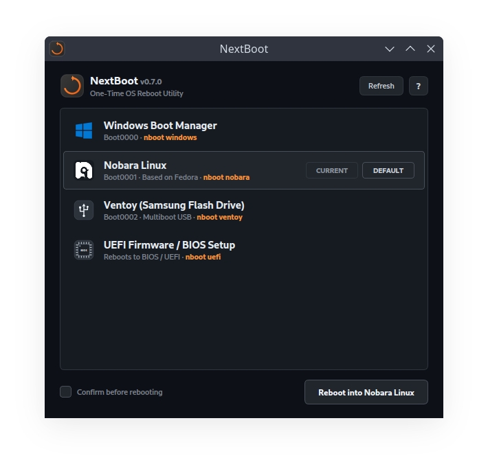
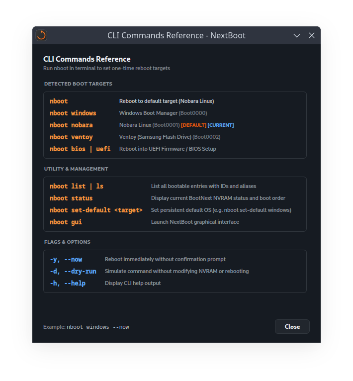

# NextBoot

NextBoot (`nboot`) is a lightweight graphical and command-line utility for Nobara and Linux systems that enables one-click and shorthand rebooting into Windows or any other operating system installed on your computer.

It utilizes the UEFI standard `BootNext` mechanism. Setting `BootNext` instructs your motherboard to boot into the selected operating system for the next boot only. Once that operating system restarts or shuts down, your computer automatically returns to your regular default boot order (Nobara/Linux).

<p align="center">
  
  
</p>

## Features

- **One-Click Reboot**: Reboot into Windows or other operating systems from a native KDE/Qt GUI or terminal command.
- **Automatic Reversion**: Subsequent boots return to your default Linux environment without manual boot menu intervention.
- **Smart Dynamic Detection**: Dynamically inspects UEFI NVRAM entries via `efibootmgr`. No hardcoded drive UUIDs or partition numbers.
- **Interactive CLI Reference**: Built-in dialog (`?` button or `F1` shortcut) dynamically displays terminal commands tailored to your active boot entries.
- **Detached Drive Friendly**: If a drive is temporarily disconnected, NextBoot detects its absence gracefully. As soon as the drive is reconnected or an OS is reinstalled, NextBoot picks it up automatically.
- **Persistent App Default**: Configure your preferred target OS once (e.g. Windows). NextBoot remembers it so you never have to re-select it every time.
- **Fast CLI Shorthands**: Intuitive commands like `nboot win`, `nboot fedora`, and `nboot bios`.
- **UEFI Firmware Setup**: Quick reboot directly into motherboard BIOS/UEFI setup.
- **Safe by Design**: Confirms intent before rebooting to prevent accidental data loss.

## CLI Usage

The primary command is `nboot` (with `nextboot` available as an alias).

### Quick Commands

| Command | Action |
| :--- | :--- |
| `nboot` | Reboot into your configured default OS (e.g., Windows) |
| `nboot win` / `nboot windows` | Reboot into Windows |
| `nboot fedora` / `nboot nobara` | Reboot into Fedora / Nobara |
| `nboot bios` / `nboot uefi` | Reboot directly into UEFI/BIOS Firmware Setup |
| `nboot ls` / `nboot list` | List all detected bootable OS entries and available shortcuts |
| `nboot status` | Display current UEFI BootNext status and default target |
| `nboot set-default <target>` | Set persistent default OS (e.g., `nboot set-default win`) |
| `nboot gui` | Open the graphical interface |

### Command Flags

- `-y`, `--now`: Skip confirmation prompt and reboot immediately (e.g. `nboot win -y`).
- `-d`, `--dry-run`: Test target resolution and simulate action without modifying NVRAM or rebooting.
- `-h`, `--help`: Display CLI help and options.

## GUI Usage

Launch **NextBoot** from your desktop application launcher (under System or Utilities) or run `nboot gui` in terminal.

The interface presents:
1. All detected bootable operating systems with official distro/OS emblems.
2. An active `CURRENT` badge indicating the currently running system.
3. A button to reboot directly into the selected OS (or double-click to reboot).
4. Direct entry to reboot into Motherboard UEFI Firmware Setup.
5. A "Confirm before rebooting" checkbox to toggle instant reboots.
6. A **`?`** button (or `F1` shortcut) providing an instant reference of CLI commands dynamically generated from your active boot entries.

## Installation

### Prerequisites

NextBoot requires:
- `efibootmgr` (standard on modern Linux installations)
- Python 3.8+
- `PyQt6` (for GUI mode)
- `systemd`

### Install Steps

Clone the repository and run the installer:

```bash
git clone https://github.com/PlasmaDrifter/NextBoot.git
cd NextBoot
sudo ./install.sh
```

The installer:
1. Installs the privileged helper to `/usr/local/libexec/nextboot-helper`.
2. Configures the scoped sudoers policy in `/etc/sudoers.d/99-nextboot` allowing members of `%wheel` to set `BootNext` without a password prompt.
3. Validates sudoers syntax with `visudo -cf`.
4. Installs the core application and executables (`/usr/local/bin/nboot` and `/usr/local/bin/nextboot`).
5. Installs the desktop launcher to `/usr/local/share/applications/nextboot.desktop`.
6. Installs bash tab completions.

## Uninstallation

To completely remove NextBoot from your system:

```bash
cd NextBoot
sudo ./uninstall.sh
```

## How It Works Under the Hood

1. NextBoot parses `efibootmgr` to locate boot entries matching operating systems.
2. When a reboot is requested, NextBoot sets the temporary UEFI variable `BootNext` to the entry ID of the chosen operating system.
3. NextBoot triggers `systemctl reboot`.
4. The motherboard reads `BootNext`, boots that operating system once, and clears `BootNext`.
5. Future boots use the standard `BootOrder`, returning you straight to Nobara.

## License

MIT License
